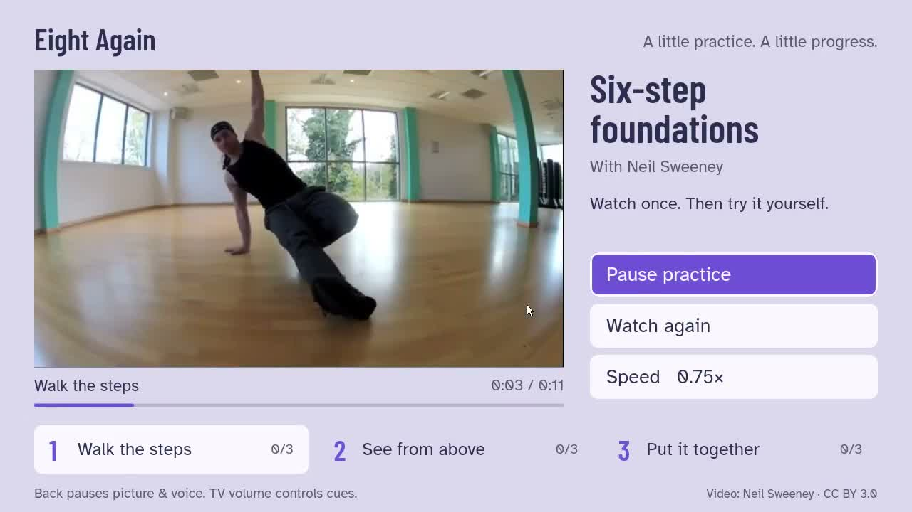

# Eight Again

Bring a dance lesson into the living room. Watch once, take five seconds, try the movement yourself, and see it again — with the TV remote in hand.

Eight Again is a native React Native application for **Fire TV with Vega OS 1.2**. Its included, openly licensed six-step lesson has three sections and three practice rounds per section. Choose 0.75× or normal speed; your own turn lasts as long as the example you just watched. Back, app backgrounding and the main button pause the routine.

**[Watch a complete practice round](https://blucca.github.io/eight-again/)** on the official Vega Virtual Device. Teachers can use the same page to arrange a free, three-section trial pack for an adult class.

[Full narrated demonstration (1:54)](https://blucca.github.io/eight-again/eight-again-demo.mp4) · [Devpost entry](https://devpost.com/software/eight-again) · [Product feedback and platform friction log](docs/submission.md#product-feedback)



**Hear when it is your turn.** Short spoken cues mark watching, preparation, your own turn and completion. The remote pauses picture and voice together; TV volume controls the prompts. Amazon Polly creates the four MP3s during pack preparation, and the installed app plays them locally. [AWS integration and cue-generation steps](docs/aws-voice-cues.md).

Section, speed and today's completed rounds stay on the device. Reopening returns to that section, ready for you to resume; a new day keeps your section and speed and starts fresh round counts. The application works with the included local media. Its source uses the platform's persistent AsyncStorage library.

## Build and run

**[Download v0.1.1](https://github.com/blucca/eight-again/releases/tag/v0.1.1)** for a ready-built development preview:

| Package | Runtime |
| --- | --- |
| `EightAgain-armv7.vpkg` | Compatible Fire TV hardware with Vega OS 1.2+ |
| `EightAgain-x86_64.vpkg` | Official Vega Virtual Device on an x86_64 host |
| `EightAgain-aarch64.vpkg` | Official Vega Virtual Device on an Apple Silicon host |

Install the [Vega SDK](https://developer.amazon.com/docs/vega/0.24/install-vega-sdk.html), start the official virtual device, and install the package matching its architecture. For an x86_64 virtual device:

```sh
vega virtual-device start
vega device install-app -p EightAgain-x86_64.vpkg -d VirtualDevice
vega device launch-app --appName io.github.blucca.eightagain.main -d VirtualDevice
```

For hardware, follow Amazon's [Developer Mode setup](https://developer.amazon.com/docs/vega/0.24/run-apps.html), use `vega device list` to get the serial, replace `VirtualDevice` with that serial, and install `EightAgain-armv7.vpkg`. Check the model and software version under **Settings → My Fire TV → About**. Initial trial targets are the Fire TV Stick 4K Select (2025) and Fire TV Stick HD (2026, second generation) after their Vega OS 1.2 update.

The release includes four offline spoken phase prompts. In the first round, listen for “Watch the movement,” pause during “Ready. Make room,” resume, and continue through “Your turn” to the automatic replay.

Use **Actions → Native television practice → Run workflow** for a clean build and an official Vega Virtual Device recording. The workflow reuses the verified [Vega TV Lab](https://github.com/blucca/vega-tv-lab) runtime: SDK 0.24.12112, React Native 0.83, Ubuntu 24.04 and KVM.

With that SDK installed locally, run `bash scripts/build.sh`. The build creates the official application shell under `temp/app`, overlays the complete source and assets in this repository, and produces VPKG files. Install the matching architecture on a compatible Vega device.

`node --experimental-strip-types src/lesson.check.ts` checks section boundaries, the shared original/slow timeline, nine-round completion, same-day and next-day progress, paused practice time, and the current-stage voice gate. The native workflow also checks the saved section, speed, rounds and media position after terminating and reopening the process.

The build uses the [documented React Native 0.83 storage alias](https://developer.amazon.com/docs/vega-api/0.24/react-native-async-storage.html): `@react-native-async-storage/async-storage` → `@amazon-devices/react-native-async-storage__async-storage@~2.1.0` in both dependencies and overrides.

### Five-minute hardware check

With the SDK connection and Developer Mode ready, install the armv7 preview using your hardware serial:

```sh
DEVICE='your-device-serial'
vega device install-app -p EightAgain-armv7.vpkg -d "$DEVICE"
vega device launch-app --appName io.github.blucca.eightagain.main -d "$DEVICE"
```

1. Start **Walk the steps** at **0.75×**. Watch the movement, **Get ready**, **Your turn**, then the automatic replay. Press Back to pause after the completed round appears.
2. Select **See from above**, set **Speed 1×**, then press Back. Note the round count and wait three seconds for the save.
3. On the same local day, terminate and reopen the process:

```sh
vega device terminate-app --appName io.github.blucca.eightagain.main -d "$DEVICE"
vega device launch-app --appName io.github.blucca.eightagain.main -d "$DEVICE"
```

The app should reopen paused on **See from above**, at **1×**, with the recorded round count. Select **Continue practice** and check that the overhead-view section actually plays.

Send **model / OS build / install result / loop result / restart result** to [belgialucca@gmail.com](mailto:belgialucca@gmail.com) or a [GitHub issue](https://github.com/blucca/eight-again/issues). An install error and its exact command output are useful results too. The [platform notes](evidence/platform-notes.md#small-local-progress) and release's `progress-check.json` show the completed virtual-device comparison.

## Native media

- `VideoPlayer` and `KeplerVideoSurfaceView` use local H.264 MP4 files through URL mode. `AudioPlayer` plays the four local Polly MP3 cues at phase transitions.
- Vega's current W3C API lists `playbackRate` as unsupported. Each speed therefore has a real, prepared video file. Original lesson seconds map to media seconds using `content / speed`.
- Chapter changes, replay and media keys use the supported `currentTime`, `play()` and `pause()` operations. Section completion follows the native media clock.
- Select activates a focused button; the D-pad moves focus. Play/pause and seek keys also work through the platform remote event API.

The official simulator is the current runtime acceptance environment. The [recorded acceptance run](https://github.com/blucca/eight-again/actions/runs/38470172329) shows the complete practice cycle, both speeds and actual playback in a new process with the saved second section, 1× speed and completed round. A hardware trial requires the actual Fire TV model, Vega OS 1.2+, and installation using the Vega SDK. Teacher delivery through Amazon Live App Testing is the next distribution step. Appstore distribution includes a compatible-device review. [Platform field notes](evidence/platform-notes.md) record the runtime, media and storage findings.

## A teacher's practice pack

Start with one short solo exercise, three section names and their time ranges. For a class trial, email [belgialucca@gmail.com](mailto:belgialucca@gmail.com) with your dance style and Fire TV model. We agree the clip's trial-use permission and teacher credit, then prepare the pack within two working days. Two adult learners can try the same exercise on two separate days.

The trial pack is free. The proposed student price for the future app is a one-off **US$9.99**. The current preview is available as ready-built VPKGs and complete source.

For a self-built pack, place the authorized 1× and 0.75× H.264 videos under `assets/raw/`; set their paths, section times, source credit and a distinct progress key in `src/lesson.ts`. Update the lesson heading and footer credit in `src/App.tsx` and the poster in `assets/images/`. Section times always refer to the original 1× video. Keep the source clip's usage terms with the resulting pack.

## Sample and licenses

The sample is **[Tutorial breakdance — Six Step](https://commons.wikimedia.org/wiki/File:Tutorial_breakdance_-_Six_Step.webm)** by **Neil Sweeney**, used under **[CC BY 3.0](https://creativecommons.org/licenses/by/3.0/)**. The Commons version is silent. We converted it from WebM to H.264, prepared a 0.75× version, selected three practice sections, and extracted a poster frame. The phase prompts are separate original text, synthesized with Amazon Polly's Joanna neural voice; the tutorial's silent soundtrack is preserved. The author retains the rights to the video; the sample credit describes the source material.

Barlow Condensed and Atkinson Hyperlegible fonts use the SIL Open Font License; license texts accompany the font files. Our application and scripts use the MIT license. Amazon's generated application shell and SDK follow their upstream licenses.
